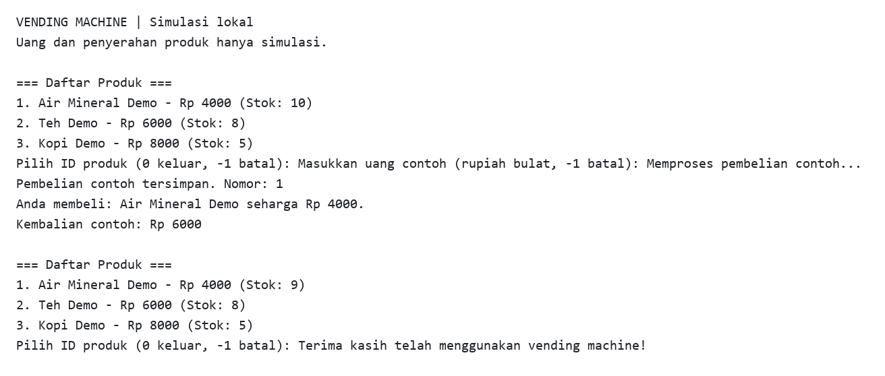

# Vending Machine Java

Simulasi pembelian satu produk melalui terminal dengan **Java 17, JDBC, dan MySQL 8.4**. Pilih ID produk, masukkan uang contoh, lalu program menyimpan catatan pembelian dan mengurangi stok dalam satu transaksi. Nomor pembelian serta kembalian baru tampil setelah database mengonfirmasi commit.

Ini latihan lokal: program tidak menerima uang nyata, menggerakkan perangkat, mengirim barang, atau menangani pembayaran. Produk, harga, dan stok awal seluruhnya contoh sintetis.

## Contoh keluaran



Keluaran asli program yang ditangkap dari eksekusi dengan database MySQL demo, lalu dirender menjadi gambar teks. Masukan berurutan: `1`, `10000`, lalu `0` untuk keluar. Gambar memuat stdout; masukan yang dikirim melalui stdin tidak ditampilkan ulang.

## Jalankan

Siapkan JDK 17, Maven 3.9, serta Docker Desktop dengan Linux containers. Di PowerShell:

```powershell
git clone https://github.com/zalamanga/vending-machine-java.git
cd vending-machine-java
Copy-Item .env.example .env
```

Isi `DB_PASSWORD` dalam `.env` dengan password database demo lokal pilihanmu, lalu:

```powershell
docker compose up -d db
docker compose ps
mvn verify
$env:DB_URL = 'jdbc:mysql://127.0.0.1:18806/vending_demo?serverTimezone=UTC'
$env:DB_USER = 'vending_demo'
$env:DB_PASSWORD = Read-Host 'DB_PASSWORD yang sama dengan .env'
java -jar target/vending-machine-java.jar
```

Tunggu status database `healthy`. Build pertama mengunduh dependency Maven. `.env` hanya dibaca Compose; Java membaca environment proses di atas. Bila `DB_PORT` diubah, sesuaikan port pada `DB_URL`. Di Linux/macOS gunakan `cp .env.example .env` dan `export DB_URL=...`, `export DB_USER=vending_demo`, serta `read -rs DB_PASSWORD; export DB_PASSWORD`.

MySQL hanya terbuka pada loopback komputer lokal. Contoh memakai TLS bawaan Connector/J dengan server demo yang mendukung TLS; mode bawaan belum memverifikasi identitas sertifikat server. Koneksi ke server lain perlu pengaturan sertifikat dan `sslMode=VERIFY_IDENTITY` yang sesuai. Tanpa Docker, jalankan `database/001-schema.sql` pada database MySQL 8.4 kosong, siapkan pengguna khusus, lalu atur ketiga environment yang sama.

## Alur terminal

- Daftar menunjukkan ID, nama, harga rupiah bulat, dan stok terbaru. ID `0` keluar; `-1` membatalkan pilihan atau uang.
- Masukan kosong, teks, negatif selain `-1`, dan angka di luar rentang integer meminta perbaikan. EOF keluar dengan rapi.
- Produk hilang, stok habis, atau uang kurang menolak pembelian tanpa mengurangi stok.
- Pembelian mengunci baris produk dengan `SELECT ... FOR UPDATE`, memeriksa stok dan harga, lalu menyimpan perubahan stok serta catatan `purchases` sebelum commit. Dua proses yang memperebutkan stok terakhir hanya dapat menghasilkan satu pembelian.
- Daftar kosong, proses pembelian, dan gangguan database memiliki pesan terminal. Tidak ada pengiriman ulang transaksi otomatis.

Jika koneksi putus saat commit, hasil transaksi dapat belum diketahui oleh program. Pesan tidak mengklaim sukses atau menjanjikan stok tetap sama. Periksa stok dan tabel `purchases` sebelum mengulang. Tabel itu menyimpan data produk dan uang contoh, tanpa akun atau data pembeli; belum ada menu riwayat, mekanisme refund, atau ID permintaan untuk deduplikasi percobaan manual.

## Data, pengujian, dan struktur

`database/001-schema.sql` membuat tabel InnoDB dan tiga produk demo pada volume baru. Aplikasi tidak menambah atau mereset stok ketika dibuka. `docker compose down` menghentikan database dan mempertahankan volume; perubahan SQL init tidak mengubah volume yang sudah ada. Mengubah password `.env` juga tidak mengganti password pengguna yang sudah tersimpan.

```text
src/main/java/vendingmachine/   Menu terminal, konfigurasi environment, transaksi JDBC
src/test/java/vendingmachine/   Tes H2 terisolasi: stok, rollback, konkurensi, commit, EOF
database/001-schema.sql         Skema dan seed sintetis
compose.yaml                   MySQL 8.4 lokal
pom.xml                        Maven, Java 17, JAR dengan dependency runtime
```

`mvn verify` hanya memakai database H2 dalam memori; tes tidak membaca environment database pengguna. Tes menyuntikkan kegagalan pencatatan dan commit, termasuk commit yang berhasil tetapi konfirmasinya hilang. H2 bukan pengganti penuh perilaku MySQL; verifikasi database native dicatat terpisah saat pemulihan.

## Asal

Dipulihkan dari proyek NetBeans `vendingmachine`, dengan mempertahankan format terminal daftar produk, pilihan ID, uang, batal, serta kembalian. Source awal mencetak sukses sebelum update stok dan tes lamanya mereset stok database langsung. Pemulihan memisahkan menu dari penyimpanan, menutup resource JDBC, memvalidasi masukan, serta membuat pembelian atomik.

Lihat [NOTICE](NOTICE). Tidak ada kredensial, database asal, konfigurasi IDE privat, hasil build, atau laporan coverage lama dalam repo. Izin source asal belum terdokumentasi, sehingga repo tidak memberikan lisensi menyeluruh baru.
