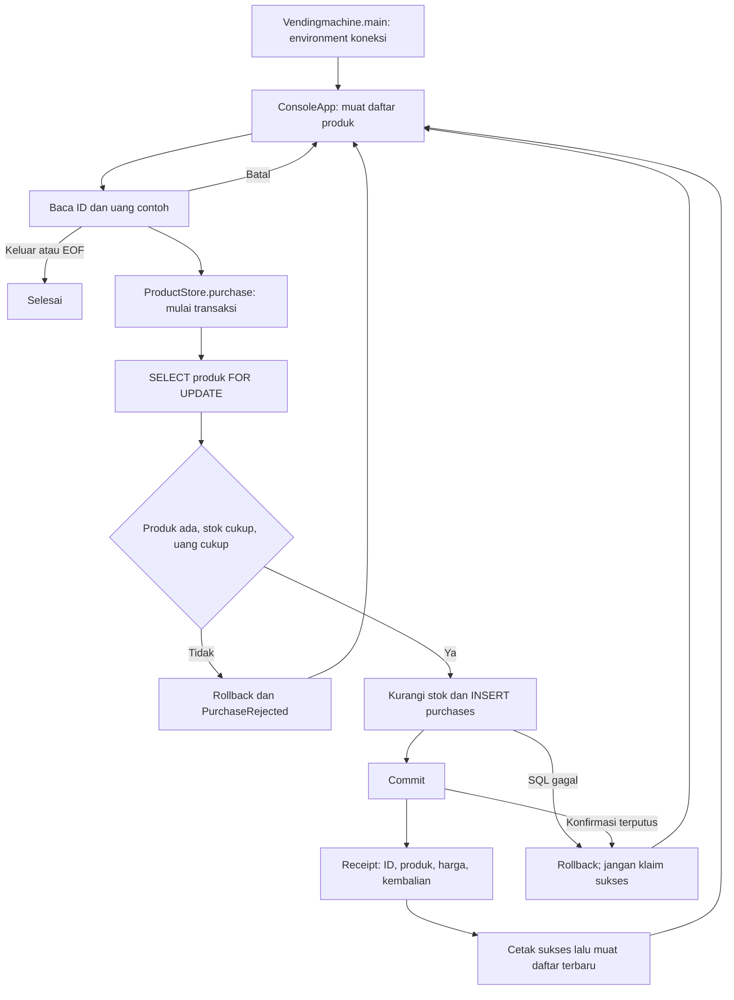

# Alur kode Vending Machine

Menu terminal memisahkan input dari transaksi JDBC. Stok dan catatan pembelian disimpan bersama; pesan sukses dicetak setelah `commit` mengembalikan hasil.

Kunci baris mencegah dua koneksi membeli unit terakhir yang sama. Catatan `purchases` menyimpan snapshot nama produk dan angka transaksi. Kegagalan sebelum commit membatalkan perubahan. Jika server sudah commit tetapi koneksi putus sebelum konfirmasi diterima, program tidak dapat menjanjikan hasilnya belum tersimpan. Ia tidak mengirim ulang operasi otomatis.

| Bagian | Sumber |
| --- | --- |
| Entry point dan environment | [Vendingmachine.java](../src/main/java/vendingmachine/Vendingmachine.java), [DatabaseConfig.java](../src/main/java/vendingmachine/DatabaseConfig.java) |
| Menu, validasi dan pembatalan | [ConsoleApp.java](../src/main/java/vendingmachine/ConsoleApp.java) |
| Daftar produk dan transaksi pembelian | [ProductStore.java](../src/main/java/vendingmachine/ProductStore.java) |
| Tabel produk/pembelian dan seed | [001-schema.sql](../database/001-schema.sql) |
| Stok, rollback, konkurensi, commit dan EOF | [ProductStoreTest.java](../src/test/java/vendingmachine/ProductStoreTest.java) |

Uang, kembalian, dan penyerahan produk hanya simulasi. Tidak ada perangkat, uang nyata, refund, atau pengiriman barang. Ikuti [README](../README.md) untuk setup dan pemeriksaan sebelum mengulang transaksi yang konfirmasinya terputus.
